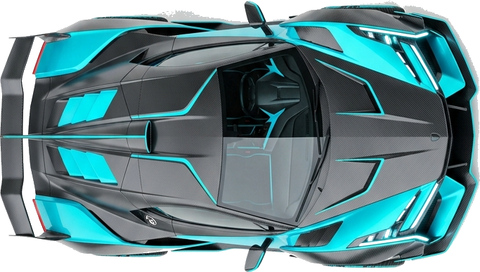

# Scroll-Driven Hero Experience — ITZ FIZZ



## About

A state-of-the-art scroll-driven hero section built with **React + GSAP ScrollTrigger**. The page features letter-by-letter headline animations on load, staggered stat reveals, and a futuristic hypercar that physically scrubs horizontally as the user scrolls — creating a premium, interactive experience.

---

## Features

- ✅ **Animated hero section** — full-screen above-the-fold layout
- ✅ **Staggered headline reveal** — per-character GSAP animation with expo.out easing
- ✅ **Animated statistics** — sequentially revealed with opacity + translateY
- ✅ **Scroll-driven main visual** — car moves right + rotates + scales on scroll
- ✅ **GSAP ScrollTrigger** — scrub: 1.2, 300vh scroll-space with sticky pinning
- ✅ **Glow trail effect** — animated trail follows the car
- ✅ **Feature section** — ScrollTrigger card reveal with stagger
- ✅ **Responsive design** — tested 375px → 1920px
- ✅ **Reduced-motion support** — `prefers-reduced-motion` respected
- ✅ **Performance-first** — transform/opacity only, no layout reflow

---

## Tech Stack

| Technology | Version |
|---|---|
| React | ^19 |
| Vite | ^8 |
| GSAP + ScrollTrigger | ^3.15 |
| Tailwind CSS | ^4 |
| JavaScript (ESM) | — |

---

## Run Locally

```bash
# 1. Install dependencies
npm install

# 2. Start dev server
npm run dev
```

Then open [http://localhost:5173](http://localhost:5173)

---

## Build

```bash
npm run build
```

Output will be in the `dist/` folder.

---

## Deployment — GitHub Pages

```bash
# 1. Add your repo URL to package.json → "homepage"
#    e.g. "homepage": "https://YOUR_USERNAME.github.io/YOUR_REPO"

# 2. Deploy
npm run deploy
```

> The `predeploy` script runs `npm run build` automatically before deploying.

---

## Live Demo

> 🔗 [https://YOUR_USERNAME.github.io/itz-fizz-scroll](https://YOUR_USERNAME.github.io/itz-fizz-scroll)

---

## Git Push Commands

```bash
git init
git add .
git commit -m "feat: scroll-driven hero experience — ITZ FIZZ"
git branch -M main
git remote add origin https://github.com/YOUR_USERNAME/itz-fizz-scroll.git
git push -u origin main
```

---

## Project Structure

```
src/
  components/
    Navbar.jsx          # Responsive nav with GSAP entrance
    Hero.jsx            # Hero section — letter-by-letter animation
    Stats.jsx           # 3 staggered stat cards
    ScrollVisual.jsx    # 300vh sticky scroll-driven car animation
    FeatureSection.jsx  # Feature cards with ScrollTrigger reveal
    CTA.jsx             # Final call-to-action
    Footer.jsx          # Minimal footer
  assets/
    hero-object.png     # Transparent hypercar PNG
  App.jsx
  main.jsx
  index.css             # Design system + Tailwind
```

---

## Evaluator Checklist

| Requirement | Status |
|---|---|
| Hero above the fold | ✅ |
| Headline has letter spacing | ✅ 0.18em |
| Statistics visible | ✅ |
| Headline animates on load | ✅ GSAP stagger |
| Statistics animate sequentially | ✅ 0.12s stagger |
| Main visual reacts to scrolling | ✅ |
| Scroll animation tied to scroll progress | ✅ `scrub: 1.2` |
| GSAP actually used | ✅ gsap + ScrollTrigger |
| Animation is smooth | ✅ transform/opacity only |
| Design is responsive | ✅ |
| Code is clean | ✅ |
| Deployable | ✅ gh-pages |
